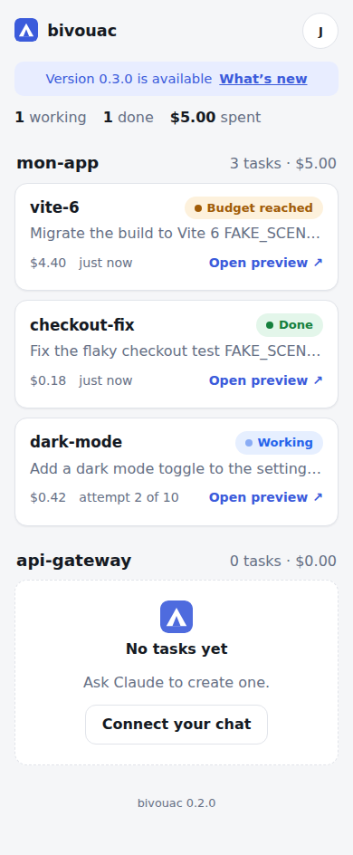
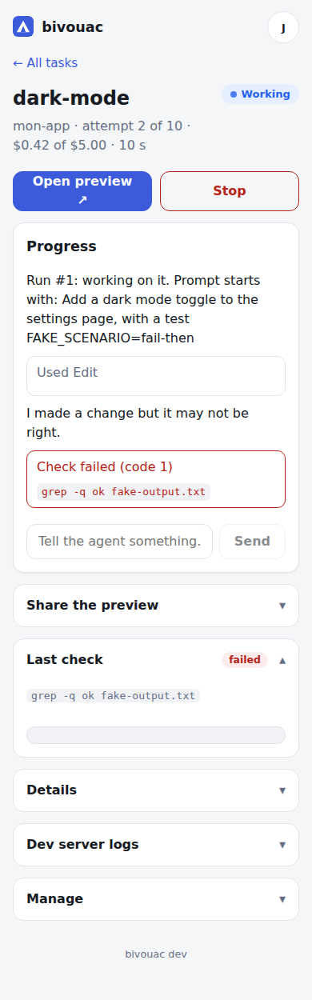
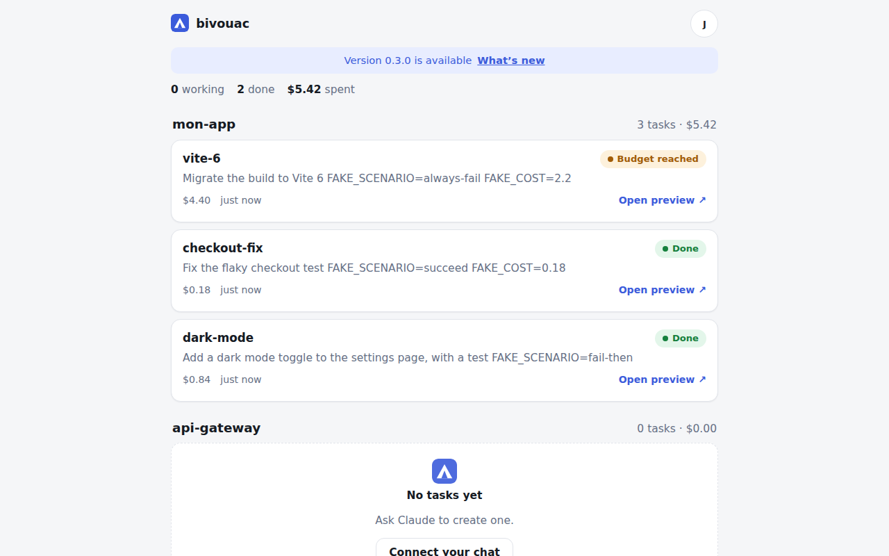

# bivouac

**Run several Claude Code agents in parallel on your own server, and drive them from a Claude or ChatGPT conversation.**

Each agent works in its own container, on its own git branch, and gets a live preview URL of the app it is building. You install bivouac with one command, click through a short setup page, add it as a connector in your chat app, and then just ask: *“Using bivouac, add a dark mode to my-app.”* The dashboard is there to follow, stop and configure.

<p align="center">
  
  &nbsp;
  
</p>
<p align="center"></p>

## Contents

[What you need](#what-you-need) · [Install](#install) · [The setup page](#the-setup-page) · [Connect your chat](#connect-your-chat) · [Daily use](#daily-use) · [Sharing a preview](#sharing-a-preview) · [Project configuration](#project-configuration-bivouacyml) · [Your own domain](#your-own-domain) · [Security model](#security-model) · [Update](#update) · [Uninstall](#uninstall) · [Troubleshooting](#troubleshooting) · [Claude subscriptions](#about-claude-subscriptions) · [Development](#development)

## What you need

- A server (VPS) with a **fresh Ubuntu 24.04** (22.04 also works), 2 vCPU and 4 GB of RAM at least; 4 vCPU / 8 GB is comfortable for several agents. Any provider works.
- **Ports 80 and 443 reachable from the internet** (open them in your provider's firewall). bivouac gets a free HTTPS certificate from Let's Encrypt.
- A **GitHub account** (you sign in with it).
- A **Claude subscription** or an **Anthropic API key** (you connect it in the setup page).
- A Claude or ChatGPT account to talk to it.

You do not need a domain name: bivouac uses `<your-ip>.sslip.io` out of the box and can switch to your own domain later.

## Install

On the server, as root (or with `sudo`):

<!-- e2e:install:start -->
```bash
curl -fsSL https://raw.githubusercontent.com/harijoe/bivouac/main/install.sh | sudo bash
```
<!-- e2e:install:end -->

There are no questions. The installer installs Docker if needed, starts bivouac, gets a certificate for `https://<ip-with-dashes>.sslip.io`, and prints a **one-time setup link** with a QR code:

```
  bivouac 0.4.0 is running. Open this link to finish the setup (it works once):

    https://203-0-113-7.sslip.io/setup?code=K7QM-4TXD
```

If the certificate cannot be obtained, the installer says exactly what to open in your provider's firewall (TCP 80 and 443) and how to retry.

## The setup page

Open the link (on your phone, scan the QR code). Five short steps, one thing per screen:

1. **Address**: keep the default, or enter your own domain (see [Your own domain](#your-own-domain)).
2. **GitHub**: bivouac creates a **private GitHub App that belongs only to you** (GitHub asks you to confirm its name). It is used to sign you in and to reach the repositories you pick. You become the administrator and the setup link is closed for good.
3. **Repositories**: choose which repositories the app may access, then add them as projects.
4. **Claude**: click *Connect Claude*, sign in on claude.ai, paste the code it shows you. (Or paste an Anthropic API key instead.) The token is stored encrypted and is valid for one year; the dashboard shows when it expires and has a *Renew* button.
5. **Chat**: copy the bivouac address into Claude or ChatGPT.

Lost the link or locked yourself out? On the server: `sudo bivouac reset-admin` prints a new one.

## Connect your chat

bivouac exposes an **MCP server** at `https://<your-address>/mcp`. Add it as a custom connector:

- **Claude (web or desktop)**: *Settings → Connectors → Add custom connector*, paste the address, *Connect*, sign in with GitHub, *Allow*.
- **Claude Code**: `claude mcp add --transport http bivouac https://<your-address>/mcp`, then `/mcp` inside Claude Code to sign in.
- **ChatGPT**: *Settings → Connectors → Advanced → Developer mode*, create a connector with the address and **OAuth** authentication.

Connected apps are listed in **Settings → Connected chat apps**, with a one-click *Disconnect*.

The tools your assistant gets: `list_projects`, `list_tasks`, `get_task`, `create_task`, `send_instruction`, `stop_task`, `resume_task`, `create_share_link`, `revoke_share_link`, `push_branch`, `open_pr`, plus two read-only tools to plan the next step: `get_project_context` and `read_project_file`. Read-only tools are marked as such, so your chat app only asks for confirmation before actions that change something. `create_task` returns immediately; the assistant follows progress with `get_task`.

**Planning the next mission from your chat.** `get_project_context(project)` returns, in one call, a compact snapshot (about 10 000 tokens): repository, default branch and last commit, the effective `bivouac.yml`, your README and project notes (`CLAUDE.md`, `AGENTS.md`, `PROGRESS.md`, `NOTES.md`, `docs/decisions.md`, `CHANGELOG.md`, shortened), the code structure (folders, languages, sizes; no file contents), recent commits, recent and running tasks (prompt, status, cost, branch, pull request state, what the agent did, last verification) and known problems. Ask for more with `detail` (`task:<name>`, `doc:<path>`, `tree`, `commits`); `read_project_file` reads one file (60 000 characters at most). It is read-only, fetches the repository from GitHub at each call with the repo-limited token, never starts a container, and never includes secrets: `.env` files, keys and files ignored by git are refused, and token-like strings are masked. The **“Plan the next mission”** prompt of the MCP server walks the conversation through it: where the project stands, what is missing, and a proposed next mission with a ready-to-run `create_task` prompt and success command.

## Daily use

You: *“Using bivouac, in my-app, create a task `login-page`: add a login form with tests. Success means `pnpm test` passes.”*

Claude creates the task and gives you its preview address, `https://login-page.my-app.<your-address>`. Ask for news (“how is login-page going?”), give instructions (“use the existing Button component”), stop it, and when you are happy: “push the branch” or “open a PR”.

How a task works: the agent runs the official `claude` CLI in its container. When it stops, bivouac runs the **success command**; if it fails, the output goes back to the agent for another attempt, until it passes or a **budget** (attempts, dollars) is reached. Every task has a **name** (lowercase letters, digits, dashes; 1 to 40 characters, unique in its project). Names are never changed automatically: if one is taken you get a clear error and pick another.

The dashboard shows what is running, with status, preview, and cost; each task has the agent's progress, the last check, dev-server logs, share links, and actions: stop, resume, rename, delete. **Renaming** takes effect immediately without restarting the container; the git branch keeps its name, and existing share links stop working.

## Sharing a preview

Previews are **private by default**: without access you see a clear “Access denied” page.

- From the dashboard, *Open preview* gives you access through a one-time ticket.
- To show it to someone else, create a **share link** (1 hour, 24 hours, 7 days, or no expiry) from the task page or ask your assistant. A link opens that one preview only, and you can list and revoke links at any time.

## Project configuration (`bivouac.yml`)

Optional file at the root of a repository (the dashboard's *Default limits* and per-project overrides sit on top of it):

```yaml
setup: pnpm install            # runs once per task workspace
runtime: { node: "26", python: "3.12" }   # optional: force tool versions (otherwise detected, see below)
dev:
  command: pnpm dev --host 0.0.0.0   # one command; it may start several servers
ports:                         # named ports; the first one is the main preview
  web: 5173
  api: 3000
services:                      # sidecars: one instance per task
  postgres:
    image: postgres:16
    env: { POSTGRES_PASSWORD: dev }
    volume: /var/lib/postgresql/data
    memory: 2g                 # default 1g, 1 CPU (a database with real data needs room: a service over its limit is killed and reported)
success: pnpm test && pnpm build
limits: { cpus: 2, memory: 4g }
budget: { max_iterations: 10, max_cost_usd: 20 }
```

See [`examples/vite-app`](examples/vite-app) (one port) and [`examples/multi-app`](examples/multi-app) (front + API + Postgres). The old `dev: { command, port }` form still works.

### Tool versions (Node, pnpm, Python, Go, Rust…)

The task image ships Node 22, but tasks use the versions your repository asks for. When a task starts, bivouac reads these files at the root of the repository — `mise.toml`, `.tool-versions`, `.nvmrc`, `.node-version`, `package.json` (`engines.node`, `packageManager`), `.python-version`, `go.mod`, `rust-toolchain(.toml)` — and installs the versions with [mise](https://mise.jdx.dev), without root, into a cache volume shared by the tasks of the project (only the first task downloads). They are on the `PATH` of `setup`, `dev`, `success` and of the agent. For `engines.node` (a range) the lowest version of the range is installed. When several files disagree the strongest wins: `package.json` < `.nvmrc` / `.node-version` < `.tool-versions` < `mise.toml` < `runtime:` in `bivouac.yml`. `runtime:` always wins; quote versions such as `"3.10"` so YAML keeps the zero.

There are no system packages (apt) and no custom image: the `image:` key of `bivouac.yml` is no longer accepted and gives a clear error. The agent may install a tool without root for a try, but must make it reproducible in `runtime:` or `setup:`; it never edits the repository to get around a version requirement. If it needs something only root can provide, it declares itself *blocked* (see below).

### When the agent cannot go on

The agent can stop on its own by writing why, and what it expects from you, to `/workspace/.bivouac/blocked.md`: the task goes to **blocked**, nothing is retried, and the reason is shown in the dashboard and in `get_task` (`error`). Answer with a message (or `resume_task` with an instruction). Independently, if two consecutive success checks fail with the same output and no change to the code in between, the task stops as **stuck** with that output.

### Several ports

Each port in `ports` gets its own address. The **first** one keeps the usual `https://<task>.<project>.<domain>`; the others are `https://<name>.<task>.<project>.<domain>` (for example `https://api.login-page.my-app.<domain>`). All of them have the same protection (owner ticket, or a share link, which opens every port of the task). The dashboard and the MCP tool `get_task` list every address. Port names are lowercase letters, digits and dashes; at most 6 ports.

### Services (Postgres, Redis, …)

Every task gets **its own instance** of each service, started before the task's setup, on the task's private network, and removed with the task (volume included). Reach it by its name: `postgres:5432`, `redis:6379` — never `localhost`, and never through a port of the server. Services have CPU and memory limits (1 CPU and 1 GB unless you set `cpus` / `memory`); at most 5 per project. A service killed for lack of memory is reported in the task history and in its log (with the limit) and started again. The agent is told which services exist and how to reach them.

### The agent can change both

Each time an agent session starts (a new attempt, a resume), bivouac reads `bivouac.yml` again from the task's working copy. A port or service the agent added gets its address or instance automatically; a removed one disappears. If the file becomes invalid the task keeps running with the last valid configuration, and the error is shown in the task view and given to the agent in its next prompt.

### Network isolation

Each task has its own Docker network (no port is published on the server; Traefik joins it to route the previews). On top of that, bivouac installs a small firewall (`bivouac-firewall.service`, removed by the uninstaller) so that a task container or a service **cannot reach anything running on the server itself**: SSH, bivouac's internal ports, Traefik's API. It cannot reach the `web` and `executor` containers either, nor the cloud provider's metadata address (`169.254.169.254`). Internet access and the traffic between a task and its own services are untouched.


### Preview, screenshots, alias and snapshots (`bivouac.yml`)

```yaml
preview:
  health: { path: /health }          # port defaults to the first port; any HTTP answer is healthy unless a path is set (then < 500)
  screenshots: ["/", "/login"]       # photographed at 375 px and 1280 px after each attempt (default: "/")
```

- **Screenshots** are taken inside the task container after each attempt, kept for the newest 12 attempts of a task (60 MB), shown in each attempt of the dashboard and returned to Claude / ChatGPT by `get_task` and `get_attempt_screenshots`.
- **Diffs**: each attempt shows the files it changed (committed or not); the **Changes** tab compares the task with its base branch; MCP `get_attempt_diff`.
- **Preview health**: a crashed or hung dev server is restarted with a growing delay (up to 8 tries), then reported as unavailable with the last cause; **Restart preview** (dashboard, MCP `restart_preview`).
- **Alias** (Settings > Projects > Preview alias): `app.<domain>` always opens the task you choose. Use it as the OAuth redirect URI or webhook URL of the app under test, and move it with the dashboard or `set_project_alias_task` when another task becomes the one to test. Webhooks come without a browser session: list their path (for example `/api/webhooks/`) under **Public paths**; everything else stays private.
- **Snapshots**: the first task whose `setup` succeeds keeps the installed dependencies; later tasks of the project start from them (3 kept per project, never secrets). Settings > Projects shows and rebuilds them.

## Your own domain

In the setup page (or later in *Settings → More settings → Address*), enter a domain such as `bv.example.com`. bivouac shows the two DNS records to create at your registrar:

| Type | Name | Value |
|------|------|-------|
| A | `bv` | your server's IP |
| A | `*.bv` | your server's IP |

Click **Verify**: bivouac waits for the records, gets the certificate and moves you to the new address. Changing the domain later **recreates the GitHub App** (its URLs are tied to the domain) and **disconnects your chat connectors**: reconnect them with the new address. Preview certificates are issued per preview, on demand (HTTP-01), so no DNS provider access is needed. Let's Encrypt allows 50 new certificates per week per registered domain; a rename needs one.

## Security model

**What is public**: the sign-in page, the setup page (only with the one-time link), the OAuth endpoints, `/mcp` (requires a token), and previews (require a ticket or a share link). Everything else requires a session.

**Who can sign in**: only GitHub accounts you allow, identified by their **numeric GitHub id** (a login can be renamed or reused). The administrator can add people, or allow all members of an organisation or team. Sessions last 30 days (`HttpOnly`, `Secure`, `SameSite=Lax`, bound to the dashboard host). **Turn on two-factor authentication on your GitHub account**: it is the key to your server.

**Two services, one with Docker access**: the public `web` service has **no access to the Docker socket**; the `executor` service, which does, is reachable only from `web` on an internal Docker network, through a narrow authenticated API (start, stop, logs, run a command in a task container). A flaw in the public side does not give control of the machine.

**GitHub access**: for every git operation bivouac mints a short-lived token limited to **one repository** and the permissions needed (contents, pull requests). That token never enters a task container. Fine-grained personal tokens remain possible as an advanced option.

**Previews**: the code of a preview is written by an agent, so it is treated as untrusted. The dashboard cookie is never sent to previews (host-only cookie), the preview cookie is removed before the request reaches the app, and tickets are single-use.

**MCP**: OAuth 2.1 with PKCE (S256 only), dynamic client registration, one-hour access tokens, rotating refresh tokens (reuse revokes the connection), tokens stored hashed. Redirect URIs are limited to claude.ai, chatgpt.com and localhost. Authorization needs a signed-in user clicking *Allow*.

**Also**: rate limiting and temporary blocking on public endpoints, a strict Content-Security-Policy, an audit log (*Settings → Recent activity*), secrets encrypted at rest with a key outside the database.

**What an agent can reach**: its own container (non-root, no Docker socket, CPU and memory limits), its own services, its repository checkout, and the internet. It cannot see other tasks, and a firewall keeps it away from everything on the server itself (SSH, bivouac's internal ports, Traefik's API, the cloud metadata address). Agents run with permissions checks disabled inside their sandbox: give them only repositories you are comfortable with.

## Update

**From the dashboard** (administrators). bivouac checks GitHub once a day for a newer published release (pre-releases and drafts are ignored); *Settings → Version → Check now* looks immediately. When a version is available, administrators see a discreet banner linking to the release notes and an **Update** button.

What the update does, in order: back up the database and the configuration (the last 3 backups are kept in `/var/lib/bivouac/backups`), download the new images, regenerate the configuration, recreate the services, wait for the new version to be healthy. **If it does not start, bivouac goes back to the previous version by itself** (images, configuration and database) and shows the reason in the dashboard. The page shows each step and reloads on the new version. Every update is recorded in *Recent activity* (who, from which version to which version, result).

If tasks are running, the default is **“update when no task is running”**: no new task can start meanwhile (an assistant that tries gets an explanation and when to retry) and you can cancel the schedule. **“Update now”** stops the running tasks cleanly (status *Stopped*; resume them afterwards). Running agents are not carried over a restart: a task container survives, but the agent session streaming from it does not, so a stop and resume is the honest way.

**Automatic updates** (off by default, *Settings → Version*): new versions are installed at night (02:00–05:00 server time), only when no task runs, with the same backup and rollback. A version that already failed is not retried automatically.

**Over SSH**: run the install command again. It uses exactly the same steps (backup, rollback included) and keeps your data and settings, including from a 0.1.x installation.

**Problems**: the progress is in `/var/lib/bivouac/web/update-status.json`; logs with `docker logs bivouac-web` and `journalctl -u bivouac`. To go back by hand: copy a folder of `/var/lib/bivouac/backups/<date>/` (`web/` = database and key, `bivouac.env`, `docker-compose.yml`) over the live files, then `cd /opt/bivouac && docker compose up -d`. Updating needs access to the registry of the images (ghcr.io by default).

## Uninstall

`sudo bash /opt/bivouac/uninstall.sh` removes the services, containers and firewall rules; add `--purge` to delete all data (including backups) and the images.

## Troubleshooting

| Symptom | What to do |
|---|---|
| The installer says it could not get a certificate | Open **TCP 80 and 443** in your provider's firewall (and `ufw allow 80,443/tcp` if the server has one), then run the installer again. |
| “Port 80/443 is already used” | Another web server runs on the machine. Stop it or move it, then run the installer again. |
| Lost the setup link / cannot sign in | `sudo bivouac reset-admin` prints a new link. |
| “This GitHub account is not allowed” | An administrator adds you in *Settings → Who can sign in*. |
| A task fails with a Claude error | *Settings → Claude → Renew* (tokens last a year). |
| `bivouac: command not found` | The installer did not finish; run it again. |
| A preview shows “Bad Gateway” | The dev server is not up yet or crashed: see *Dev server logs* in the task. |
| Preview certificate warning right after a rename | The certificate for the new address is being issued (a few seconds). |
| The update did not work | The dashboard says why and bivouac is back on the previous version. Check `docker logs bivouac-web`, then try again or run the installer over SSH. |
| A task cannot reach a service (`postgres`) | Use the service name as the host (`postgres:5432`), not `localhost`, and wait for it to start (a database needs a few seconds). |
| A task needs to reach something on the server itself | This is blocked on purpose (see *Network isolation*). Expose it on the Internet or run it as a service in `bivouac.yml`. |
| Chat app cannot connect | Check the address ends with `/mcp`, that it uses HTTPS, and that you signed in with an allowed GitHub account. |

Logs: `docker logs bivouac-web`, `docker logs bivouac-executor`, `docker logs bivouac-traefik`.

## About Claude subscriptions

bivouac runs the **official `claude` CLI** and signs in through `claude setup-token`; it does not reimplement the API. Usage counts as Claude Code usage on your subscription, and Anthropic's policy on this may change, which is why using an **Anthropic API key** is supported too.

## Development

```bash
pnpm install
pnpm build && pnpm lint && pnpm typecheck && pnpm test    # unit tests, fake claude
pnpm test:integration                                      # real Docker + Traefik + the daemon image
node packages/daemon/dev/demo-server.mjs                   # the UI with demo data (no Docker)
node scripts/screenshots.mjs                               # 390 px and 1280 px screenshots of every screen
scripts/e2e-fresh-vps.sh [--real] [--domain] [--ghcr]      # end to end on a new Hetzner VM (needs HCLOUD_TOKEN)
```

Packages: `shared` (types, stream-json parser), `daemon` (web service, executor, CLI), `dashboard` (React), `task-image` (container image, fake claude).

## License

MIT
